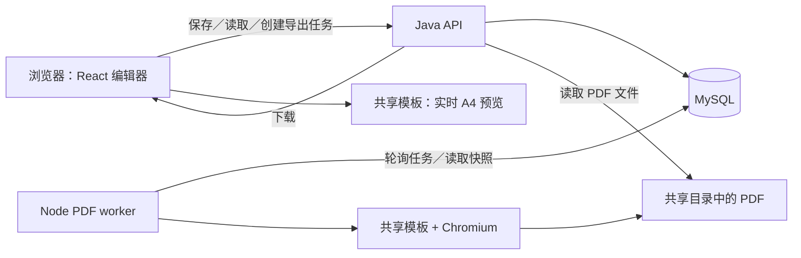

# Resume Do · 简历工作台

项目标识统一为 `resume-do`：Java 包名 `com.resumedo`，启动类 `ResumeDoApplication`，Maven 坐标 `com.resumedo:resume-api`，npm workspace `@resume-do/*`。本地与 Docker 默认数据库、数据库账号均为 `resume_do`，环境变量使用 `RESUME_DO_*`。目录、Java 包、SQL 标识与环境变量分别遵循各自命名规则。业务表名和 `/api/resumes` 等接口保持原来的业务含义。

**从旧版本升级时，先停止 API 和 worker，并按[命名与数据迁移说明](docs/ops/2026-10-28-internal-naming-migration.md)备份、迁移旧库。直接启动新版不会自动找到旧数据库中的简历。**

一个支持简历编辑、实时 A4 预览、模板切换和 PDF 导出的 Web 项目。项目采用 npm Workspaces 管理前端、PDF worker 和共享 TypeScript 包，Java API 使用 Maven 单独管理。

当前包含 261 套参数化简历皮肤（其中 30 套来自 Ardot「模板版 30 套」设计稿，编号 `a1`–`f5`；170 套来自 Ardot「新模板 · IT技术 60 / 白领通用 60 / 电商运营 50」，编号 2000–2169），新增 PDF 参考版式「灰阶技术」（`2170`，灰底栏目、三列个人信息、黑白紧凑单栏，无头像和页码，仅复用版式）；支持基本信息、求职意向、教育背景、专业技能、工作经历、项目经验、自我评价、实习经验、技术实践和待整理内容的内容编辑，以及照片上传、模块显隐与排序、重命名、自动保存。模板参考图片位于 `docs/template-reference`，它们是设计参考，实际预览和 PDF 由项目自己的渲染代码生成。

> 默认导入 PDF 文字层 / DOCX 后直接进入编辑器，保留原件供对照与下载，不经过校对表单。照片与扩展信息从原文提取，缺失项不补造。扫描件、OCR、旧版 .doc 与像素级版式复刻不在可编辑导入范围。导入后默认使用「原样还原」模板（主题色取自原件、照片在左、分区标题条、时间/单位/角色单行），分区按原件出现顺序排列；「核心项目经历」识别为项目经历，「技术实践」保留独立模块；未匹配分区表的标题（如「个人项目」）及其后内容统一放到末尾「待整理内容」，遇到下一个已匹配标题再恢复归类。PDF 字号/标题样式与 DOCX 标题样式提供标题边界，纯文本使用独立标题词形兜底；待整理内容逐行保留，不进行断行合并或提取基本信息，页首无标签字段（性别、工作年限、城市、期望薪资、到岗时间、意向职位）可识别，抬头按原件居中/左对齐与是否带标签自适应，原件没有照片时不生成头像，样例页数与分区归属和原件一致；字体不同仍可能带来个别换行差异。原件版保持原始字节和页数，见[导入原样式还原验证](docs/ops/2026-10-29-import-style-fidelity-verification.md)。

## 1. 技术架构

| 层次 | 使用技术 | 职责 |
| --- | --- | --- |
| Web 前端 | React 19、TypeScript 5、Vite 6 | 编辑表单、富文本编辑、自动保存、模板选择、实时预览、导出任务状态展示 |
| 共享数据模型 | TypeScript、Zod 3 | 简历结构、字段约束、模板编号、默认数据及校验 |
| 共享模板引擎 | TypeScript、HTML/CSS、htmlparser2、sanitize-html | 260 套皮肤、内容块生成、富文本清洗和分页；前端与 PDF worker 共用 |
| Java API | JDK 21、Spring Boot 3.5.16、Spring Security、Spring JDBC、jsoup、PDFBox 3.0.8 | 注册登录、Session 认证、简历读写、revision 冲突检查、内容校验、PDF／DOCX 本地解析导入、原件关联、导出任务与下载 |
| 数据库 | MySQL 8.4、Flyway | 存储用户、简历 JSON、导出任务与导入草稿；应用启动时自动迁移表结构 |
| PDF worker | Node.js 22、TypeScript、Playwright、mysql2 | 轮询数据库任务队列，启动 Chromium 渲染 A4 PDF，更新任务状态 |
| 文件存储 | 本地磁盘／Docker 共享卷 | 保存 PDF 与 API 私有导入原文件，API 与 worker 必须使用同一数据目录 |
| 容器部署 | Docker Compose、Nginx | 编排 MySQL、API、worker 和静态前端；Nginx 代理 `/api/` |

富文本编辑目前使用浏览器 `contentEditable` 及编辑命令；项目没有接入 TipTap。数据访问使用 Spring JDBC，没有使用 MyBatis 或 JPA。任务队列使用 MySQL 表，不要求额外安装 Redis、RabbitMQ 或 Kafka。



编辑器顶栏「打印预览」位于「下载 PDF」旁，直接打开浏览器打印界面，仅输出当前编辑内容的 A4 简历（包括尚未保存的修改），不依赖 PDF worker。打印前等待字体、照片及分页稳定，内容溢出或资源加载失败时提示调整后重试；取消打印不改变编辑内容和预览缩放。建议浏览器选择 A4、100% 缩放、关闭页眉页脚并开启背景图形；用户与打印机设置可能影响最终输出。

编辑版导出先保存简历，再由 API 固定 revision 快照并创建任务，worker 生成后下载。**编辑器中的“下载 PDF”统一导出当前编辑版，需要 worker。** 原件仍可通过“查看原件”中的下载入口获取，不依赖 worker。

### 模板收藏

“更换模板”中，每张卡片左上角的星标可收藏或取消收藏。点击星标不会选中或应用模板；收藏立即按登录账号保存，取消弹窗不会撤销。下次登录、刷新或换设备后，在“我的收藏”中可快速查找和套用，搜索及风格筛选可同时使用。首次没有收藏时显示引导；加载或保存失败会提示重试，不会把失败操作显示为已收藏。

首次运行新版 Java API 时，Flyway 会执行 `V7__template_favorites.sql` 新建收藏表。收藏只记录用户与模板编号，不记录简历内容。接口为 `GET /api/template-favorites`、`PUT /api/template-favorites/{templateId}` 与 `DELETE /api/template-favorites/{templateId}`，均要求登录。

## 2. 目录结构

```text
resume-do/
├── apps/
│   ├── api/                 # Java / Spring Boot 后端，pom.xml
│   ├── web/                 # React / Vite 前端
│   └── pdf-worker/          # Node / Playwright PDF 任务进程
├── packages/
│   ├── schema/              # 共享数据模型、Zod 校验
│   └── templates/           # 模板目录、样式、内容块及分页
├── deploy/                  # Dockerfile、Compose、Nginx 配置
├── docs/                    # 需求、实现计划、参考图库、验证记录
├── data/                    # 本地运行数据，PDF 位于 exports/，临时导入位于 imports/；Git 忽略
├── .env.example             # 环境变量示例，不会自动加载
├── package.json             # npm Workspaces 与根目录命令
└── package-lock.json        # Node 依赖锁定文件
```

## 3. 本地需要准备的环境

以下是直接在电脑运行源码的要求；如果使用第 9 节 Docker 方式，则宿主机主要需要 Git 和 Docker Compose。

| 软件 | 建议版本 | 说明 |
| --- | --- | --- |
| Git | 可用版本即可 | 用于从实际仓库地址拉取源码，也可以解压源码包 |
| JDK | **21** | 后端编译目标是 Java 21，JDK 8 无法运行本项目 |
| Maven | **3.9.x** | 项目没有 Maven Wrapper，需要本机 Maven 或 IDEA 内置 Maven |
| Node.js | **22.x** | `package.json` 要求 Node >= 22；本项目曾使用 22.23.2 验证 |
| npm | Node 22 随附版本 | 使用 npm Workspaces，在项目根目录统一安装依赖 |
| MySQL | **8.4.x** | 迁移使用 `utf8mb4_0900_ai_ci`；不要直接换成 MySQL 5.7 或 MariaDB |
| PDF 浏览器 | Playwright Chromium，或已安装的 Chrome | 仅 PDF worker 需要；两种配置方式见下文 |
| 编辑器 | IntelliJ IDEA / VS Code 等 | IDEA 用于 Java 开发时需配置 JDK 21 |

第一次安装依赖、下载浏览器、构建 Docker 镜像时，需要能访问相应依赖仓库。

先检查终端实际使用的版本：

```bash
java -version
mvn -v
node -v
npm -v
mysql --version
```

`mvn -v` 中的 Java 版本也应为 21。Apple Silicon Mac 请选择 arm64 的 Node、JDK；Intel Mac 请选择 x64，避免出现 `Bad CPU type in executable`。

## 4. 获取代码与安装依赖

从团队提供的实际 Git 仓库地址克隆后，进入 `resume-do` 根目录；本文不预设远程仓库地址。如果拿到的是源码压缩包，解压后进入包含根 `package.json` 的目录即可。

```bash
cd /你的项目路径/resume-do
npm ci
```

不要分别进入每个 workspace 执行安装。`npm ci` 会按根目录锁文件安装依赖并建立共享包链接。

下面的 `export`、`source`、`set -a` 命令适用于 macOS / Linux 的 Bash、Zsh；Windows 可以使用 Git Bash，PowerShell 配置方式见第 6 节。

## 5. 准备 MySQL

先启动本机 MySQL，再使用有建库和授权权限的账号登录：

```bash
mysql -u root -p
```

执行以下 SQL。示例密码 `change_me` 请自行替换，并与后续配置保持一致：

```sql
CREATE DATABASE IF NOT EXISTS resume_do
  CHARACTER SET utf8mb4 COLLATE utf8mb4_0900_ai_ci;

CREATE USER IF NOT EXISTS 'resume_do'@'localhost' IDENTIFIED BY 'change_me';
CREATE USER IF NOT EXISTS 'resume_do'@'127.0.0.1' IDENTIFIED BY 'change_me';
GRANT ALL PRIVILEGES ON resume_do.* TO 'resume_do'@'localhost';
GRANT ALL PRIVILEGES ON resume_do.* TO 'resume_do'@'127.0.0.1';
```

如果用户已经存在，`CREATE USER IF NOT EXISTS` 不会修改原密码，请使用该用户的实际密码。验证 TCP 连接：

```bash
mysql -h 127.0.0.1 -P 3306 -u resume_do -p resume_do
```

只需要创建数据库和用户。后端首次启动时，Flyway 自动执行 `apps/api/src/main/resources/db/migration` 下的迁移：V1 创建用户、简历和导出任务，V2 新增 `import_jobs`。不要手动重复执行迁移 SQL。已有部署升级前先停止 API 和 worker，备份数据库与数据目录，再启动新版执行 V2；不要改写已有 V1。

## 6. 配置文件与环境变量

后端按 Spring profile 拆分配置：

| 文件 | 用途 | 提交规则 |
| --- | --- | --- |
| `apps/api/src/main/resources/application.yml` | 公共配置；未指定 profile 时使用 `prod` | 可提交 |
| `apps/api/src/main/resources/application-local.yml` | 本地数据库默认值、相对数据目录 | 可提交无真实凭据的示例；真实密码用环境变量 |
| `apps/api/src/main/resources/application-prod.yml` | 部署数据库配置、默认 `/data` 目录 | 可提交；数据库密码必须从 `RESUME_DO_DB_PASSWORD` 注入 |

本地显式启用 `local`（第 7 节命令与共享 IDEA 配置已设置），Docker Compose 显式启用 `prod`。profile 文件会随 JAR 打包，但只有选中的 profile 生效；不要将真实密码、密钥或私人连接地址写入这些受 Git 跟踪的文件。也不要通过 `spring.profiles.active: local` 写死公共配置。

API 与 PDF worker 是独立进程：worker 不读取 Java YAML，仍使用根 `.env`，数据库和数据目录必须与 API 一致。下面的配置供两者共用。

在项目根目录复制配置示例：

```bash
cp .env.example .env
```

按自己的数据库修改 `.env`。下面是一份可供 Bash / Zsh 加载的配置示例：

```bash
# API 和 PDF worker 共用同一套连接配置
RESUME_DO_DB_HOST=127.0.0.1
RESUME_DO_DB_PORT=3306
RESUME_DO_DB_NAME=resume_do
RESUME_DO_DB_USER=resume_do
RESUME_DO_DB_PASSWORD=change_me
RESUME_DO_STORAGE_DIR=../../data
RESUME_DO_API_PORT=8080
RESUME_DO_WEB_PORT=5173
RESUME_DO_BROWSER_CHANNEL=
```

本地示例密码为 `change_me`，请与建库时的密码保持一致。密码含空格、`$` 等字符时，加载前使用适当的 shell 引号。

Spring Boot 不自动加载根目录 `.env`；根命令 `npm run dev:worker` / `npm run dev` 会自动加载它，直接运行 worker workspace 命令仍需手动加载。每个启动 API 或直接运行 worker 的终端，先在项目根目录执行：

```bash
set -a
source .env
set +a
export RESUME_DO_STORAGE_DIR="$PWD/data"
mkdir -p "$RESUME_DO_STORAGE_DIR"
```

Vite 会读取根目录 `.env` 中的 `RESUME_DO_WEB_PORT` 和 `RESUME_DO_API_PORT`，用于开发服务端口和 API 代理。这些变量不以 `VITE_` 开头，不会作为前端环境变量暴露给浏览器。生产静态页面通过 Nginx 的 `/api/` 代理访问后端。

| 配置 | 作用与默认值 |
| --- | --- |
| `RESUME_DO_DB_HOST / PORT / NAME / USER / PASSWORD` | API、worker 共用的数据库配置；本地默认 127.0.0.1 / 3306 / resume_do / resume_do / change_me；API 的 prod 不提供密码默认值 |
| `RESUME_DO_API_PORT` | 后端端口，8080；同时决定 Vite 代理目标 |
| `RESUME_DO_WEB_PORT` | 本地 Vite 端口 5173；Docker 示例对外端口 8080 |
| `RESUME_DO_STORAGE_DIR` | API 和 worker 的同一数据目录；local API／worker 默认相对各自应用目录 `../../data`，prod API 默认 `/data`，推荐显式指定同一绝对路径 |
| `RESUME_DO_BROWSER_CHANNEL` | 留空使用 Playwright Chromium，`chrome` 使用本机 Chrome |
| `RESUME_DO_DOWNLOAD_TTL_MINUTES` | 下载有效期，10 分钟 |
| `RESUME_DO_POLL_MS / RENDER_TIMEOUT_MS` | worker 轮询间隔 800ms / 生成超时 30000ms |
| `RESUME_DO_DB_POOL_SIZE` | worker 连接池大小，4 |
| `RESUME_DO_WORKER_ID` | worker 标识，默认主机名和进程号 |
| `RESUME_DO_LEASE_SECONDS / HEARTBEAT_MS / MAX_ATTEMPTS` | 任务租约 90 秒 / 心跳 20000ms / 最多尝试 3 次 |
| `RESUME_DO_CODE_TTL_SECONDS / COOLDOWN_SECONDS` | 注册验证码有效期 600 秒 / 重发冷却 60 秒 |
| `RESUME_DO_CODE_DAILY_LIMIT / HOURLY_LIMIT` | 同一邮箱或手机号每天最多 10 次、同一 IP 每小时最多 30 次 |
| `RESUME_DO_MAIL_ENABLED / MAIL_HOST / MAIL_PORT / MAIL_USERNAME / MAIL_PASSWORD / MAIL_FROM / MAIL_FROM_NAME` | 邮箱验证码的 SMTP 配置；`MAIL_ENABLED=false` 时邮箱通道返回 503 `CODE_DELIVERY_UNAVAILABLE` |
| `RESUME_DO_SMS_ENABLED / SMS_SECRET_ID / SMS_SECRET_KEY / SMS_SDK_APP_ID / SMS_SIGN_NAME / SMS_TEMPLATE_ID` | 腾讯云短信通道，模板参数依次为验证码和有效分钟数；`SMS_ENABLED=false` 时手机号通道返回 503 |

注册需先通过「人机验证」拿到 `captchaTicket`，再请求验证码。`local` profile 设置 `app.verification.expose-code: true`：通道未配置时不实际发信，验证码写入 API 日志并随 `/api/auth/verification-codes` 响应的 `devCode` 返回，方便联调；本地填好 `RESUME_DO_MAIL_*` 后会用真实 SMTP 发信、不再返回 `devCode`。`prod` 永远不返回该字段。

旧的项目环境变量不再兼容；请删除 IDEA 运行配置中的旧变量，并按上表填写。`JAVA_HOME`、`NODE_ENV`、`PLAYWRIGHT_BROWSERS_PATH` 等工具标准变量继续使用标准名称。

### Windows PowerShell

PowerShell 不支持 `source .env`，可在每个启动终端逐项配置：

```powershell
$env:RESUME_DO_DB_HOST = '127.0.0.1'
$env:RESUME_DO_DB_PORT = '3306'
$env:RESUME_DO_DB_NAME = 'resume_do'
$env:RESUME_DO_DB_USER = 'resume_do'
$env:RESUME_DO_DB_PASSWORD = 'change_me'
$env:RESUME_DO_STORAGE_DIR = Join-Path (Get-Location) 'data'
```

IDEA 的 Java 运行配置同样需要单独填写这些变量，不会继承另一个终端的 `source .env`。

## 7. 启动本地开发环境

需要运行 **MySQL + Java API + Web + PDF worker**。MySQL 先启动，随后启动 API；Web 与 worker 可以在各自终端运行。

推荐启动方式：API 仍按下面方式在 IDEA 或终端启动；Node 进程可在根目录统一启动，避免遗漏 PDF worker：

```bash
# 前置：npm ci 已完成；根 .env 已配置为与 API 相同的数据库和数据目录
# 首次安装一次浏览器
npm run install:browser -w @resume-do/pdf-worker
# 同时运行 Web 与 PDF worker，Ctrl+C 同时停止
npm run dev
```

使用本机 Chrome 时，在根 `.env` 设置 `RESUME_DO_BROWSER_CHANNEL=chrome` 后执行 `npm run dev`。不要同时再运行单独的 Web / worker 命令，否则会重复启动。以下分进程步骤仍可用于分别调试。

未指定浏览器时默认使用 Playwright Chromium；macOS 上若其可执行文件缺失，worker 会尝试使用 `/Applications` 下已安装的 Google Chrome，并打印切换日志。显式设置的浏览器不会自动切换。浏览器不可用时返回 `BROWSER_UNAVAILABLE` 和具体操作提示，完整异常仅写入 worker 终端；安装浏览器或修正配置后重新发起导出。

### 7.1 Java API：终端一

先按第 6 节在项目根目录加载环境变量并设置绝对数据路径，然后执行：

```bash
cd apps/api
mvn spring-boot:run -Dspring-boot.run.profiles=local
```

也可以打包后运行：

```bash
# 在 apps/api 目录执行
mvn -DskipTests package
java -jar target/resume-api-0.1.0.jar --spring.profiles.active=local
```

看到 `Started ResumeDoApplication` 和 `Tomcat started on port 8080` 表示启动成功。

### 7.2 Web 前端：终端二

在项目根目录执行：

```bash
npm run dev:web
```

浏览器打开 **http://localhost:5173/**。开发时 `/api` 会由 Vite 代理到 `http://127.0.0.1:8080`，不需要在前端代码填写数据库连接或单独配置跨域。

如果修改了 API 端口，在根目录 `.env` 设置 `RESUME_DO_API_PORT` 并重启 Vite。若 5173 被占用，Vite 可能选择其他端口，请以终端输出为准。

### 7.3 PDF worker：终端三

先在项目根目录加载第 6 节的环境变量并设置绝对数据路径，然后选下面一种浏览器方式。

**方式 A：使用 Playwright 自带 Chromium。** 首次安装一次：

```bash
npm run install:browser -w @resume-do/pdf-worker
```

启动：

```bash
npm run dev:worker
```

Linux 如果提示缺少系统库，可使用 `npx playwright install --with-deps chromium` 安装浏览器及所需系统依赖；安装系统依赖可能需要管理员权限。

**方式 B：使用本机已安装的 Google Chrome。** 无需单独下载 Playwright Chromium：

```bash
RESUME_DO_BROWSER_CHANNEL=chrome npm run dev:worker
```

PowerShell 对应：

```powershell
$env:RESUME_DO_BROWSER_CHANNEL = 'chrome'
npm run dev:worker
```

根目录 `npm run dev:worker` 会加载根 `.env`，并在 `apps/pdf-worker` 工作目录启动；已有终端环境变量优先。修改 `.env` 后需重新运行命令。

看到 `pdf worker started` 只代表进程启动；还应确认没有持续出现 `claim failed` 数据库错误。worker 本身不监听 HTTP 端口，因此不能通过查看 8080 来判断 worker 是否运行。

### 7.4 首次使用与检查

1. 打开 Web 页面并注册账号。项目没有预置可直接使用的管理员密码。
2. 登录后进入简历库：没有简历时显示空态，可“创建第一份简历”或导入 PDF / DOCX；已有简历时点击卡片进入编辑器，填写内容并等待“已保存”。
3. 打开“更换模板”，点击卡片选中模板；悬停卡片点“预览”（触屏常驻）可按当前简历内容查看整页 A4 效果，再点“使用此模板”回到列表，最后点击“应用”。取消会丢弃本次排版草稿。
4. 点击“下载 PDF”，等待 worker 完成并自动下载。worker 日志应出现 `export ready`。
5. 关闭三个运行终端中的服务可按 `Ctrl+C`。Session 保存在 API 进程内，重启后端后可能需要重新登录。

### 7.5 导入简历 v2.2

1. 点击顶栏“导入简历”会先弹出“简历覆盖提示”，确认覆盖并导入后才选择 PDF / DOCX（≤20MiB）。本地解析完成后直接覆盖当前正在编辑的简历内容，无中间校对表单。扫描件没有文字层时明确拒绝，不调用 OCR 或第三方 AI。
2. 覆盖导入原位更新同一份简历：ID 不变，顶部简历名称自动取新上传文件名（去掉 PDF / DOCX 扩展名，最多 100 字），revision 递增，原件替换为新上传文件，原件版导出保持可用；不新增简历，不占用额外名额。每账号最多 5 份未删除简历。
3. 旧版原件简历仍可逐页按原尺寸、旋转方向等比渲染，不强制 A4。Word 原件可下载为 DOCX，浏览器不提供 Word 原版预览；可编辑内容正常预览。
4. 编辑器中的“下载 PDF”只导出当前编辑内容与模板，不再提供原件版选择。弹窗展示文件名、A4 纸张和预览页数，点击“下载 PDF”后先保存最新修改，再固定 revision 快照，由现有 worker 生成并自动下载。保存失败时不创建导出任务；生成失败可重试，已生成文件可再次下载。编辑不会修改原件，原件仍可通过“查看原件”中的下载入口获取；重新排版后的页数可能与原件不同。
5. 基本信息支持出生年月与年龄、籍贯、民族、婚姻状况、政治面貌、身高体重与自定义键值。没有出生年月时年龄可直接编辑，留空后预览与编辑版导出都不展示；填写出生年月后改为按当前月份自动计算并锁定，原文年龄仍保留在数据中。头部联系方式与基本信息按字段配内联 SVG 图标（性别、城市、工作年限、电话、邮箱、出生年月、年龄、籍贯、民族、婚姻状况、政治面貌、身高、体重），自定义字段没有固定语义，保持文字标签。基本信息与求职意向的字段可用字段旁 ↑/↓ 调整前后顺序，顺序写入文档的 `fieldOrder`，预览顶部联系行、扩展信息行、经典模板信息网格与求职意向行同步生效；姓名与照片固定，自定义字段始终排在标准字段之后。其他缺失项留空，导入不推测缺失内容。内嵌照片尽力提取，失败不阻断正文；“展示照片”默认开，关闭后预览与编辑版导出均隐藏照片并保留数据，原件版不改变。
6. 编辑页顶栏提供“清空内容”，二次确认后把当前简历内容重置为空白，保留简历名称与排版；操作无法撤销，建议先导出 PDF 备份。顶栏“删除”把简历移入回收站（原件与内容一起保留 30 天，可在简历库恢复），彻底删除需在回收站二次确认；原件文件缺失时返回 410。

编辑页顶栏依次为“导入简历”“清空内容”、账号、“↓ 下载 PDF”“退出”；预览区最后一页下方依次显示页码胶囊“第N页（共M页）”和“↓ 下载 / 导出简历”大按钮，二者随内容滚动，滚到最底部才出现，不悬浮固定；顶部“下载 PDF”与底部大按钮打开同一个导出弹窗。可编辑视图提供“查看原件”（有原件时）与“删除”，不再展示简历切换下拉；切换简历请回到简历库。

编辑内容自动保存，每次保存成功后左下角提示“时:分:秒 保存成功！”，不再提供手动保存按钮。排版工具栏只保留带图标的“间距设置”“字体 / 语言”“皮肤设置”“更换模板”，预览页在可用区域内居中。编辑区模块标签整行居中、按可用宽度自适应收缩，自定义模块标题过长时省略显示，悬停可看全名。

“字体 / 语言”弹窗提供系统黑体、系统宋体、Arial、思源黑体（Noto Sans SC）、思源宋体（Noto Serif SC）、霞鹜文楷（LXGW WenKai）六种字体。后三款为 SIL OFL 1.1 开源字体，随项目部署：前端只在用户选中时动态加载该字体的 CSS 与 woff2 分片，`unicode-range` 保证只请求简历实际用到的字符分片；PDF worker 镜像通过 `fonts-noto-cjk`、`fonts-lxgw-wenkai` 安装同一套字体，并在分页测量和最终导出前等待 `document.fonts.ready`。字体文件加载失败时自动回退到系统字体，不影响编辑与导出。

模块标签提供显示开关、左右移动和铅笔就地重命名（1–20 字，回车或失焦保存，Esc 取消）；置灰的隐藏模块悬停显示红色减号，二次确认后删除该模块及内容，删除后标签行重新居中，可见模块需先关闭开关再删除。行末圆形「＋」新增自定义模块并自动选中。基本信息、求职意向固定显示，不参与模块开关与排序；两个固定页签内部字段可用 ↑/↓ 调整展示顺序。记录类模块左侧为列表卡片，字段采用灰底四列布局，窄屏降为两列／一列。旧简历首次打开时自动补齐缺失的内置模块（隐藏、空内容），只在首次编辑后写库，不重排已有模块，也不改变已有内容；保存后文档带 `moduleDefaultsApplied` 标记，此后删除的模块不会在重新打开时被自动加回。

正文编辑器工具栏支持撤销 / 恢复、字号（12–24px）、文字颜色、加粗 / 斜体 / 下划线、链接、有序 / 无序列表、左 / 中 / 右 / 两端对齐、插入图片与清除格式；字号与颜色需先选中文字。图片在浏览器内压缩（最长边 1600px、WebP 优先，单张 data URL ≤ 约 800KB）后以 `data:image/(png|jpeg|webp);base64` 内嵌正文，并写入 `width` / `height` 预留版面，预览与编辑版 PDF 按 `max-width: 100%` 自适应；单条正文上限 4,000,000 字符（纯文本总量仍限 100,000）。输入 Markdown（`**加粗**`、`*斜体*`、`[文字](https://…)`、`- ` 或 `1. ` 列表）在补全标记时立即转换，粘贴的 Markdown 文本同样转换，失焦时再兜底转换残留的字面标记；样式与图片由客户端 `sanitize-html` 与服务端 Jsoup 白名单双重校验。

正文编辑器下方提供「AI 润色」「精炼内容」两个按钮，采用用户自带 DeepSeek API Key 的浏览器直连模式：未配置时只显示「开启 AI 改写」，在「AI 设置」中填写 Key（默认存 `localStorage`，可选仅本次会话）、选择 `deepseek-flash` / `deepseek-v4-pro` 并启用。每次发送前展示将发送的纯文本正文和意向职位，用户勾选同意后由浏览器直接调用 `https://api.deepseek.com/chat/completions`，Key 与正文不经过 Resume Do 服务器，费用计入用户自己的 DeepSeek 账户；不会发送姓名、电话、邮箱、照片、完整简历或 PDF。返回结果同时展示原文、建议与风险提示，可取消、重新生成或采用；生成期间正文被修改时，采用前会再次确认。采用后进入现有编辑与自动保存流程，AI 调用本身不写简历。服务端 `POST /api/ai/rewrite` 与 `RESUME_DO_AI_*` 配置保留为休眠的旧链路，Web 已不再调用。本期不提供 AI 生成或整份简历优化。

界面提供「浅色 / 深色 / 跟随系统」三态主题，首次访问默认深色，深色取自 Ardot「Resume Do 封面 V2 登录同源版」调色板（页面 `#171D23`、面板 `#242B32`、输入框 `#333C45`、正文 `#EDF1F3`、文本绿 `#45B45A`）。切换即时生效；登录后写入 `users.theme_preference`（Flyway `V5__user_theme.sql`），未登录使用 `localStorage` 的 `resume-do:theme` 兜底，登录后以服务端值为准。首屏内联脚本在 React 启动前应用主题，避免闪白。应用外壳、弹窗、空状态与提示条共用一套 token；A4 预览、模板缩略图、原件画布与导出的 PDF 始终为白色纸张，深色下通过描边与阴影区分纸张边界。登录页按同一封面排版：左上品牌块、右上三态开关、卡片头、`本地优先 · 简历数据不出你的设备` 胶囊与分段 Tab，窄屏下自动收紧。接口为 `GET /api/auth/me` 返回 `themePreference`，`PATCH /api/auth/me` 接受 `{ "themePreference": "light" | "dark" | "system" }`，非法值返回 400，详见[主题偏好接口](docs/api/auth-me.md)与[暗黑主题验证记录](docs/ops/2026-10-30-dark-theme-verification.md)。

原件存于服务器 `data/resumes/<publicId>.pdf` 或 `.docx`，数据库保存路径、文件名、字节数、SHA-256 与 PDF 页数，保留至删除简历。临时上传/无引用孤立文件由本模块清理，不清理有效原件。

默认 API：`POST /api/imports/direct` 创建关联原件的 `structured` 简历；`POST /api/imports/direct/{id}` 覆盖当前可编辑简历（同一 ID，名称取新文件名去掉扩展名，revision+1，替换原件，旧文件提交后清理）；`GET /api/resumes/{id}/source` 读取原件，`?download=1` 下载；`DELETE /api/resumes/{id}` 删除两个视图。旧 L1 `kind=original` 仍兼容；显式点击“返回编辑器”调用 `POST /api/imports/from-original/{id}` 在原 ID 上解析为可编辑内容，不额外占名额。不会在启动时批量修改旧简历。

旧校对弹窗与草稿接口保留但不作为默认入口；确认时原件复制到正式简历，确认成功后清理临时文件。默认直入路径不创建 `import_jobs`。

前端联调契约见 [resume-do OpenAPI](docs/api/resume-do-openapi.yaml)（OpenAPI 3.1，覆盖认证、简历、原件、导入、导出与 AI 共 28 个端点，包含 Session 鉴权、错误码、限额与字段结构）。其他前端接手时先读该文件；现有前端调用实现位于 `apps/web/src/api.ts`。

PDF.js worker、本地 cMaps、标准字体与 WASM 随包构建，不使用 CDN。导入覆盖本身不需要新迁移；尚未应用 V3 时先停止 API 与 worker、备份库与数据目录，再启动 API 执行 V3。暗黑主题另需应用 `V5__user_theme.sql`（已有用户默认 `dark`）。升级时先备份，再启动 API 让 Flyway 依次应用迁移，最后重启 API / worker，刷新前端。功能验收由用户执行，见[交付记录](docs/ops/2026-10-29-import-v22-handoff.md)。

### 7.6 简历库与回收站

登录后默认进入简历库（卡片网格），卡片展示姓名、意向职位、模板主题色、可编辑/原件标记与最近编辑时间：

- 顶栏两个视图切换：“我的简历”与“回收站”，按钮实时显示数量。
- 新建与导入都在列表页完成；卡片悬停可重命名（回车保存、Esc 取消）或删除；每账号最多 5 份未删除简历，达上限时新建按钮禁用并提示先删除。
- 删除为软删：把简历连同原件移入回收站，保留 30 天，期间可在回收站“恢复”或“彻底删除”。恢复会重新校验 5 份上限；彻底删除同时移除数据库记录、导出任务与原件文件，不可撤销。
- 后台每分钟清理超过 30 天的回收站记录及其原件；恢复不依赖后台任务，文件在彻底删除前一直保留。
- 空态提供“创建第一份简历”，回收站空态说明保留期限。

对应 API：`GET /api/resumes`（默认在用；`?deleted=1` 返回回收站，按删除时间倒序）、`POST /api/resumes/{id}/restore`、`DELETE /api/resumes/{id}`（移入回收站）、`DELETE /api/resumes/{id}?purge=1`（彻底删除，要求记录已在回收站，否则 409 `RESUME_NOT_TRASHED`）。

## 8. IntelliJ IDEA 配置

可以打开整个 `resume-do` 目录查看完整项目，再通过 Maven 工具窗口添加／导入 `apps/api/pom.xml`。重新加载 Maven 后，可使用共享运行配置 `.run/ResumeDoApplication.run.xml`；若保留旧配置，删除后重新创建，避免引用旧包或模块。

- **Project SDK、模块 SDK**：选择 JDK 21。只有 JDK 8 时，先安装 JDK 21，再添加到 IDEA SDK 列表。
- **语言级别、Java 编译目标**：设为 21，避免“源发行版 21 需要目标发行版 21”。
- **Maven Importer / Runner JDK**：选择 JDK 21。
- **启动类**：`apps/api/src/main/java/com/resumedo/ResumeDoApplication.java`。
- **程序参数**：`--spring.profiles.active=local`（共享运行配置已设置）；PowerShell 与 Bash/Zsh 均可使用上述参数。
- **运行配置环境变量**：填写第 6 节的 `RESUME_DO_DB_*`；`RESUME_DO_STORAGE_DIR` 建议填写根目录 `data` 的绝对路径。
- **工作目录**：建议设为 `apps/api`。如使用相对存储路径，目录不同会改变 `../../data` 的含义。
- **Node.js 解释器**：选择 Node 22。IDEA 旧终端不会自动刷新 PATH，切换 Node 后关闭旧终端标签，再新开终端检查 `node -v`。

IDEA 的 Java 运行配置不会自动继承另一个终端执行 `source .env` 后的变量，需要单独填写。前端及 worker 可以继续在 IDEA 的两个终端中按第 7 节启动。

启动日志已开启 ANSI 配色，默认显示带头像、经历、教育和技能区域的“Resume Do · 简历工作台”横幅。可以修改 `apps/api/src/main/resources/banner.txt` 定制图案；日志格式和颜色开关位于 `application.yml` 的 `logging.pattern.console`、`spring.output.ansi.enabled`。修改后需重启后端。

## 9. 可选：Docker Compose 运行

与 cost 共用云服务器时使用独立的 [云端部署与 GitHub CI/CD 流程](docs/ops/2026-10-30-cloud-cicd.md)：`deploy/compose.cloud.yaml` 仅发布 `127.0.0.1:8081`，使用独立数据库和文件卷，通过 SSH 隧道访问。下面的通用 Compose 示例仍用于独立环境，不要在 cost 所在服务器直接使用默认 8080。

CI 检查与自动部署分别判断。只修改测试代码、测试目录内的样例/夹具、`docs/`、根目录 README（含 `README.MD`）、发布规划脚本或该 CI 工作流时，仍运行相应检查，但不自动构建发布包、上传服务器或部署。测试变更暂不从已有服务检查范围和发布指纹中剔除，以兼容历史部署基线；因此文档/测试推送仍可能检查上次成功部署以来积累的服务变化。本次 push 没有运行代码或部署输入变化时，不会顺便重试之前失败的发布；下一次包含运行变更的发布仍会纳入这些积累变化。若无法确定本次 push 的前置提交，仅检查；手动运行工作流并选择 `full=true` 可明确要求全量发布。PR 始终只检查，不部署。

仓库包含容器配置，但此前本机验证未覆盖 Docker 镜像构建与运行。首次使用仍需在自己的 Docker 环境验收，尤其是 Chromium 和中文字体。

在项目根目录执行：

```bash
cp deploy/.env.example deploy/.env
# 修改 deploy/.env 中的两个密码，再启动
# RESUME_DO_MYSQL_ROOT_PASSWORD、RESUME_DO_DB_PASSWORD 不可留空

docker compose --env-file deploy/.env -f deploy/compose.yaml config --quiet
docker compose --env-file deploy/.env -f deploy/compose.yaml up --build -d
docker compose --env-file deploy/.env -f deploy/compose.yaml logs -f resume-api resume-worker
```

访问 **http://localhost:8080/**，或 `deploy/.env` 指定的 `RESUME_DO_WEB_PORT`。

- API 显式使用 `SPRING_PROFILES_ACTIVE=prod`；这是 Spring 标准变量。线上直接运行 JAR 时可传 `--spring.profiles.active=prod`，并注入实际数据库密码和共享数据目录。
- Compose 项目名为 `resume-do`，服务名为 `resume-db`、`resume-api`、`resume-worker`、`resume-web`。
- 本地与容器数据库默认均为 `resume_do`，账号同名。MySQL 镜像的 `MYSQL_*` 键是镜像标准接口，由 Compose 从项目的 `RESUME_DO_*` 变量传入。
- MySQL 卷为 `resume_do_mysql_data`；API 与 worker 共用 `resume_do_files` 卷中的 `/data`。
- 只有 Web 发布端口；本机 Java 占用 8080 时，可把 Docker 的 `RESUME_DO_WEB_PORT` 改为 8088。
- 停止使用 `docker compose --env-file deploy/.env -f deploy/compose.yaml down`。不要添加 `-v`，会删除数据卷。
- **旧 Compose 数据卷不会自动接入新项目。** 升级前必须先备份并迁移数据库及文件卷，详见迁移说明。MySQL 镜像初始化变量只在空数据目录生效，修改密码变量不会更改现存数据库账号密码。
- 当前提供 HTTP；公网部署需配置域名、HTTPS、安全 Cookie 和自己的密码。

### 9.1 过期 PDF 清理

worker 启动后及此后每分钟检查过期导出，每批最多 50 条，仅删除已完成且 `expires_at` 已到期的 PDF。删除成功后清空任务的 `file_key`，保留任务、快照和审计字段；文件已不存在时可安全重试。清理失败会记录 `export cleanup failed` 或 `export cleanup file failed` 并保留记录重试。停止 worker 时不执行清理，积压超过 50 条时会分批处理。

下载有效期由 `RESUME_DO_DOWNLOAD_TTL_MINUTES` 控制，默认 10 分钟；过期文件删除后无法恢复，需重新导出。清理不删除简历、用户或整个数据卷，也不清理孤立文件和 `.tmp` 文件。本轮已验证文件删除边界，尚未完成真实 MySQL 与多 worker 清理联调。

## 10. 测试与构建

以下 npm 命令在项目根目录执行：

```bash
npm run typecheck   # 检查全部 TypeScript workspace
npm test            # schema、模板与 worker 快照测试；默认跳过真实浏览器 PDF 测试
npm run build       # 前端生产构建，输出 apps/web/dist
```

浏览器回归测试（项目根目录，需要本机 Chrome）：

```bash
npm run build
npm run test:e2e
```

该测试直接加载生产构建，通过 Playwright 拦截请求提供内存 API，不启动 HTTP 监听、不连接真实数据库。覆盖 A01 保存后重载、A05 模板与字号取消／应用、A06 的 1／3／5 页预览与块边界／超长单段溢出提示、导入覆盖与释放，以及主题默认深色、三态切换、服务端持久化、跟随系统、纸张保持白色与登录页封面 V2 的品牌块和隐私胶囊；不代表真实 API、数据库与 PDF 下载全链路通过。测试默认使用 Chrome；若使用已安装的 Playwright Chromium，Bash/Zsh 设置 `RESUME_DO_BROWSER_CHANNEL=chromium`，PowerShell 设置 `$env:RESUME_DO_BROWSER_CHANNEL = 'chromium'` 后运行。2026-10-30 在本机 Chrome 下 5 个用例全部通过。

Java 测试与打包：

```bash
cd apps/api
mvn test
mvn package
```

Java 单元测试不要求启动 MySQL。若受限环境中 Mockito 提示无法 self-attach，这是测试 JVM agent 加载问题，应按实际依赖版本配置 Mockito agent；不要因此修改业务代码或更换成 JDK 8。

真实 PDF 集成测试可独立运行，不需要 API 或数据库，但需要可启动的浏览器：

```bash
# 在根目录执行；使用已安装 Chrome
RESUME_DO_BROWSER_CHANNEL=chrome npm run test:pdf -w @resume-do/pdf-worker

# 可选：保留生成文件以检查页数、文字与版式
RESUME_DO_BROWSER_CHANNEL=chrome RESUME_DO_PDF_TEST_OUTPUT_DIR=/你的绝对路径/pdf-check npm run test:pdf -w @resume-do/pdf-worker
```

PowerShell 下可绕过当前 `test:pdf` 脚本中的 POSIX 赋值语法，在项目根目录执行：

```powershell
$env:RESUME_DO_RUN_PDF_TESTS = '1'
$env:RESUME_DO_BROWSER_CHANNEL = 'chrome'
npm test -w @resume-do/pdf-worker
```

测试覆盖 260 套模板生成、多页照片内容与侧栏溢出拒绝。编写了测试用例不等于本机已通过；请以自己的执行结果及实际 PDF 检查为准。API 与 worker 的模板／渲染版本必须一致升级，不能只更新其中一个进程。

导出界面区分“排队等待 PDF 服务接单”和“生成中”。未进入渲染时等待约 30 秒会提示检查 worker；进入渲染后总等待最多约 3 分钟，单次查询最多 15 秒。超时保留原任务，可点击“检查进度”继续查询；只有终态失败或过期后重试才创建新任务。前端超时不代表服务器任务已取消。

## 11. 常见问题

| 现象 | 排查方式 |
| --- | --- |
| Maven 提示插件要求版本 ≥ 3.6.3 | 终端正在使用旧 Maven；运行 `mvn -v`，切换到 Maven 3.9.x 和 JDK 21。不要降级项目编译插件 |
| 导入接口返回错误或不存在 | 在 IDEA 重载 Maven 并完整重启 API，确认日志包含 V2 迁移及最新主类启动；仅热替换旧进程不会注册新 Controller |
| 导入提示损坏、密码保护或扫描版 | 根据明确错误处理；解密、另存 DOCX 或提供有文字层的 PDF，原文件与人工校对保留供重试 |
| `Port 8080 was already in use` | 已有 API 或其他服务占用端口；先确认占用进程，避免重复启动 |
| `env: node: Bad CPU type in executable` | Node 架构与电脑不匹配，或终端仍使用旧 PATH；安装正确架构并新开终端 |
| Java 提示源／目标版本不一致 | 检查项目 SDK、模块 SDK、编译目标、Maven JDK 是否都为 21 |
| `[mysql-explain]` 查询 `performance_schema.user_variables_by_thread` 权限报错 | IDEA 的 RestfulBox → Java 工具 → MySQL Explain 取消“启用”，应用后重启后端；这是插件自动注入导致，无需给业务账号授予系统表权限。该开关是 IDEA 全局设置 |
| `Access denied` / `Communications link failure` | 检查 MySQL 是否启动、用户授权、密码、端口及库名；API 和 worker 都要配置 |
| 复制 `.env` 后仍使用旧密码 | API 和 worker 不自动读 `.env`；在当前终端加载，或在 IDEA 运行配置显式设置 |
| `/api` 请求失败 | 检查后端是否启动；开发代理目标是否与 API 端口一致 |
| PDF 一直“正在生成” | 检查 worker 是否单独启动、数据库是否与 API 一致，以及是否有 `claim failed` 日志 |
| Playwright 找不到 executable | 安装 Chromium，或设置 `RESUME_DO_BROWSER_CHANNEL=chrome` 使用本机 Chrome |
| PDF 显示完成但下载提示文件不存在 | 检查 API 和 worker 的 `RESUME_DO_STORAGE_DIR` 是否为同一绝对路径 |
| 下载链接过期 | 默认有效期 10 分钟，重新创建导出任务 |
| 提示正文／侧栏超高 | 手动拆分长段落、缩短侧栏或调整字号／行距，不会静默导出被裁切内容 |
| 换模板后 API 报编号或版本不支持 | 确认 Java API 与 worker 都已用最新源码重新启动 |
| 不同电脑的预览与 PDF 换行略有差异 | 系统黑体／系统宋体／Arial 仍随操作系统变化；选择思源黑体、思源宋体或霞鹜文楷时，前端与 PDF worker 使用同一套随项目部署的字体。更新后需重新构建 worker 镜像以安装 `fonts-lxgw-wenkai` |

macOS / Linux 可查看端口：

```bash
lsof -nP -iTCP:8080 -sTCP:LISTEN
lsof -nP -iTCP:5173 -sTCP:LISTEN
```

Windows 可使用 `netstat -ano | findstr :8080`。不要直接强制结束所有 Java / Node 进程，以免影响其他项目。

A06 当前仅部分完成：按段落／列表项分页，超长单段提示并阻止导出，尚未实现逐行跨页。原验收要求仍保留，本轮未豁免，也不标记全部通过。浏览器回归和 Docker 字体差异尚未完成验收，详见[本轮修复与验证记录](docs/ops/2026-10-29-review-follow-up.md)。

更详细的本地测试记录见 [本地验证记录](docs/ops/2026-10-28-resume-p0-local-verification.md)。需求与实现计划位于 [docs/superpowers](docs/superpowers)。

## 公网访问

- 工具首页：https://xiachen.xyz
- 简历工作台：https://resume.xiachen.xyz
- 记账小程序服务：https://cost.xiachen.xyz（保留既有接口 https://api.xiachen.xyz）

共享 HTTPS 网关、证书续期、隔离边界、验收和回退见 [公网部署记录](docs/ops/2026-10-31-public-https.md)。
